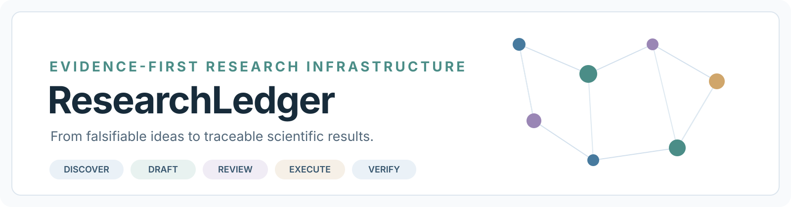
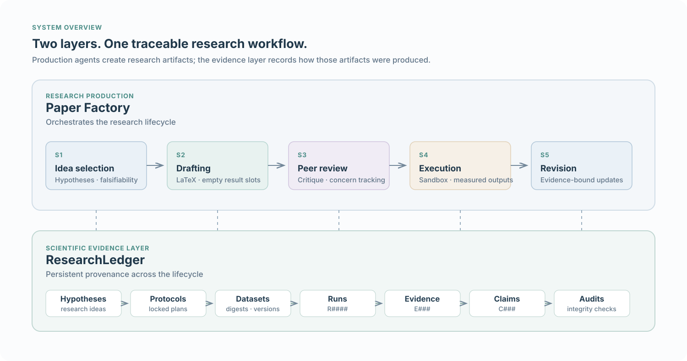
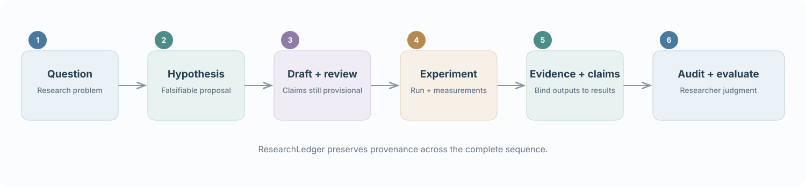
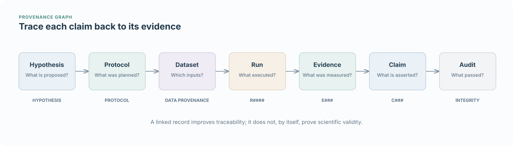
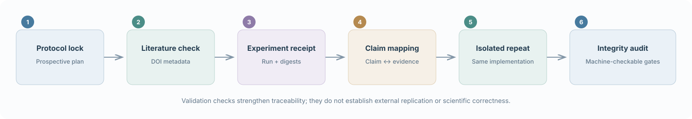

<div align="center">



[](https://www.python.org/)
[](pyproject.toml)
[](docs/EVIDENCE_FIRST_V2.md)
[](https://arxiv.org/abs/2607.02520)

**Discover · Draft · Review · Execute · Verify**

[Quick start](#-quick-start) · [Architecture](#-architecture) · [Evidence model](#-evidence-model) · [Validation](#-validation-mode) · [Documentation](#-documentation)

</div>

---

## What is ResearchLedger?

**ResearchLedger connects agentic research production to a traceable scientific evidence record.**

It combines two complementary components:

| Paper Factory | ResearchLedger |
|---|---|
| Coordinates idea selection, manuscript drafting, AI-assisted review, experiment execution, and revision. | Tracks hypotheses, protocols, datasets, runs, evidence, claims, and integrity checks. |

The goal is to make it possible to inspect how a research claim relates to the experiment and evidence behind it—not merely generate a convincing manuscript.

> [!IMPORTANT]
> ResearchLedger is a research prototype, not a certifier of scientific correctness, novelty, independent replication, or publication readiness. Automated audits check defined machine-verifiable conditions only. Human scientific judgment remains essential.

## 🧠 Architecture



**Two connected layers:** Paper Factory coordinates research work; ResearchLedger records the provenance and evidence relationships created along the way.

## 🔄 The research lifecycle



| Stage | What happens |
|---|---|
| **S1 — Idea selection** | Generate candidates and assess falsifiability. |
| **S2 — Drafting** | Create a LaTeX draft with empty result slots. |
| **S3 — Review** | Produce structured referee feedback. |
| **S4 — Execution** | Run experiments in a restricted Docker environment. |
| **S5 — Revision** | Bind measured outputs to manuscript result slots. |

## 🔗 Evidence model



Research records use stable identifiers:

- **C###** — manuscript claims
- **E###** — evidence artifacts
- **R####** — experimental runs

The intended progression is:

**Hypothesis → Recorded execution → Checked evidence → Provisional claim → Researcher evaluation**

A machine-checked result is not automatically an independently established scientific finding.

## ✨ Capabilities

<table>
<tr>
<td width="50%" valign="top">

**Research discovery**

- Candidate idea generation
- Critical-persona evaluation
- Numerical falsifiability criteria

**Manuscript and review**

- LaTeX drafting
- Empty result placeholders
- Structured referee assessments
- Bounded revision cycles

</td>
<td width="50%" valign="top">

**Experimentation**

- Docker-based isolated execution
- Recorded code and input provenance
- Measured outputs and artifacts

**Evidence and integrity**

- Claim-to-evidence bindings
- Dataset and code digests
- Protocol and metric checks
- Isolated experiment repeats

</td>
</tr>
</table>

## 🚀 Quick start

### Requirements

- Python **3.10+** and `pip`
- Authenticated **Claude Code CLI**
- Docker Desktop or Docker Engine
- `pdflatex` and `bibtex`
- Pinned runtime image and offline dependency setup for experiments

See [START_HERE.md](START_HERE.md) for vendor and template dependencies.

### Install

```bash
git clone https://github.com/raja21068/ResearchLedger.git
cd ResearchLedger
python -m pip install -e .
researchctl doctor
```

### Create and run a project

```bash
researchctl init "brain tumor robustness"
```

Edit `_inputs/topic.md` in the workspace path printed by the command, then run:

```bash
researchctl run --project brain-tumor-robustness
researchctl status brain-tumor-robustness
researchctl ledger brain-tumor-robustness
researchctl audit brain-tumor-robustness
```

New workspaces normally live under `~/.local/share/paperfactory/workspaces/`. Override this location with `PAPERFACTORY_WORKSPACES`.

**Authentication:** the CLI uses your existing Claude Code login; a separate Factory API key is not required.

**Packaging note:** editable installation uses the source checkout. A standalone non-editable wheel is not currently supported.

## 🛡️ Validation mode

Exploration mode is the default. **Validation mode is opt-in** and requires an operator-reviewed protocol and declared result contracts before the validation run.

Set this field in `_inputs/context.json` before running the project:

```json
{
  "science_mode": "validation"
}
```

Then follow the operator sequence:

```bash
researchctl run --project brain-tumor-robustness --to S1
researchctl protocol lock brain-tumor-robustness
researchctl literature verify brain-tumor-robustness --doi YOUR_REAL_DOI
researchctl literature audit brain-tumor-robustness
researchctl run --project brain-tumor-robustness --from S2 --to S4
researchctl claims scaffold brain-tumor-robustness
researchctl claims bind brain-tumor-robustness
researchctl reproduce-isolated brain-tumor-robustness
researchctl science-audit brain-tumor-robustness
```

Replace `YOUR_REAL_DOI` with a valid DOI. Complete the protocol, prior-art register, and claim bindings before their corresponding checks. A successful audit does **not** establish scientific validity or publication readiness.



## 🧩 Agents and integration boundaries

| Component | Location | Status |
|---|---|---|
| Idea selection | `factory/steps/idea.py` | Default Factory S1 |
| Factory peer review | `factory/steps/review.py` | Default Factory S3/S5 |
| Evidence infrastructure | `researchledger/`, `factory/science/` | Integrated; validation is opt-in |
| Idea Discovery v5 | `vendor/idea-generation/idea-discovery-v5.zip` | Bundled distribution; complete internal workflow and default S1 invocation not validated here |
| Referee Lean v2 | [`Referee Lean v2 README`](vendor/20-%20Paper%20Review%20Agent/Referee-Lean-v2/README.md) | Bundled; not every standalone function is invoked by default |

**Presence is not integration:** a component in `vendor/` is not necessarily executed during every `researchctl run`. See the [integration guide](docs/INTEGRATION.md).

## 🧪 Tests

```bash
python -m unittest discover -s tests -p 'test_*.py'
python -m pytest -q tests_researchledger
researchctl test
```

Passing tests establish only the conditions they exercise. Full model, Docker, LaTeX, dataset, and end-to-end workflows require execution in the appropriate local environment.

## 📚 Documentation

| Guide | Use it for |
|---|---|
| [Getting started](START_HERE.md) | Installation and first project |
| [Architecture](docs/ARCHITECTURE.md) | Factory stages and system design |
| [Integration](docs/INTEGRATION.md) | Factory–Ledger boundaries |
| [Evidence-first v2](docs/EVIDENCE_FIRST_V2.md) | Protocol locking and validation |
| [Scientific readiness](docs/SCIENTIFIC_READINESS.md) | Checked, provisional, and verified states |
| [Research-agent comparison](docs/RESEARCH_AGENT_COMPARISON.md) | Agent landscape and 10-dimension matrix |
| [Engineering audit](docs/DEEP_CODE_AUDIT_2026-10-08.md) | Implementation and release audit |

## 📊 Research-agent landscape

The [research-agent comparison](docs/RESEARCH_AGENT_COMPARISON.md) examines systems including AI Scientist-v2, Google Co-Scientist, Robin, A-Lab, Agora, EviGraph, IDEAgent, ReviewGrounder, DeepReviewer, Paper2Agent, and PaperOrchestra.

The comparison is qualitative and architecture-based; it is **not** a benchmark claim that ResearchLedger outperforms these systems.

## 📄 Related research

**AutoResearch: An Execution-Grounded Multi-Agent Framework for Reliable Research Workflow Automation**

Rajesh Kumar, Waqar Ali, Junaid Ahmed, Abdullah Aman Khan, Shaoning Zeng.

- [arXiv:2607.02520](https://arxiv.org/abs/2607.02520)
- [DOI: 10.48550/arXiv.2607.02520](https://doi.org/10.48550/arXiv.2607.02520)
- [Source repository](https://github.com/raja21068/AutoResearch)

AutoResearch is a related but separate framework. Its results should not be interpreted as validation of this repository.

```bibtex
@misc{kumar2026autoresearch,
  title={AutoResearch: An Execution-Grounded Multi-Agent Framework for Reliable Research Workflow Automation},
  author={Kumar, Rajesh and Ali, Waqar and Ahmed, Junaid and Khan, Abdullah Aman and Zeng, Shaoning},
  year={2026},
  eprint={2607.02520},
  archivePrefix={arXiv},
  primaryClass={cs.CY},
  doi={10.48550/arXiv.2607.02520}
}
```

## 🤝 Contributing

Contributions are especially useful in evidence validation, reproducibility, provenance, failure analysis, agent integration, independent benchmarking, and testing. Include reproducible test cases and state what each test does—and does not—establish.

## 📜 License

The repository retains the upstream ResearchLedger Apache-2.0 license text at [`licenses/RESEARCHLEDGER_APACHE-2.0.txt`](licenses/RESEARCHLEDGER_APACHE-2.0.txt). Vendored components may have separate licenses and attribution requirements; inspect them before redistribution.

---

<div align="center">

**Generated research is a starting point. Evidence is the standard.**

[Get started](START_HERE.md) · [Explore the architecture](docs/ARCHITECTURE.md) · [Inspect the science gates](docs/EVIDENCE_FIRST_V2.md)

</div>
