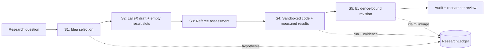

<div align="center">

# ResearchLedger × Paper Factory

### An evidence-first research workflow — from falsifiable ideas to traceable results

**Generate ideas · Draft manuscripts · Simulate peer review · Execute experiments · Audit claims**

[](https://www.python.org/) [](pyproject.toml) [](docs/EVIDENCE_FIRST_V2.md) [](https://arxiv.org/abs/2607.02520)

[**Quick start**](#-quick-start) · [**How it works**](#-how-it-works) · [**Scientific safeguards**](#-scientific-safeguards) · [**Agent landscape**](docs/RESEARCH_AGENT_COMPARISON.md) · [**Documentation**](#-documentation)

</div>

---

## Why ResearchLedger?

A research assistant can produce a convincing paper even when its experiments do not run, its citations are unverified, or its findings cannot be traced back to data. **ResearchLedger combines an agentic paper-production pipeline with an explicit scientific evidence ledger**, making the distinction between *generated text*, *executed measurements*, and *independently established findings* visible.

**Paper Factory** orchestrates idea selection, LaTeX drafting, AI review, isolated code execution, and revision. **ResearchLedger** tracks hypotheses, runs, provenance, evidence status, and claim relationships. The opt-in **validation mode** adds prospective protocol and result-integrity checks before finalization.

> [!IMPORTANT]
> This is research software, **not** a scientific correctness, novelty, independent-replication, journal-acceptance, or Q1-publication certifier. An automated integrity pass confirms defined machine-checkable conditions only. Domain expertise, research ethics, statistical scrutiny, and independent review remain essential.

## ✨ Highlights

| Capability | What it does for researchers |
| --- | --- |
| **Falsifiable idea selection** | Generates candidate research ideas, scores them through two critical personas, and enforces measurable falsification criteria. |
| **Evidence-aware writing** | Drafts with **empty result placeholders** first; inserts numerical findings only from explicitly bound executed outputs. |
| **Scientific review and revision** | Produces structured manuscript feedback, checks concerns, and supports bounded revision rounds. |
| **Isolated experiments** | Runs generated experiments inside a network-restricted Docker environment; retains code, result, and input provenance. |
| **ResearchLedger provenance** | Connects claims **C###**, evidence **E###**, and runs **R####** using digests and validation checks. |
| **Opt-in validation gates** | Locks research protocol and dataset, audits prior-art metadata, checks metric mappings and registered seeds, and performs isolated repeats. |
| **Bundled specialist tools** | Includes [Referee Lean v2](#-specialist-agents-and-integration-boundaries) and an Idea Discovery v5 archive, distinct from the default Factory stage implementations. |

## 🔄 How it works



**Exploration mode** is the default and yields exploratory results. **Validation mode** is opt-in and requires an operator-reviewed, prospectively locked protocol and declared result contracts. It does not retroactively turn a pilot into a confirmatory study.

## 🚀 Quick start

### Prerequisites

- **Python 3.10+**, `pip`, an authenticated **Claude Code CLI**, and a local LaTeX toolchain (`pdflatex`, `bibtex`).
- **Docker Desktop or Docker Engine** for experiment execution; a pinned runtime image and offline dependency setup are expected.
- Vendor/template dependencies described in [START_HERE.md](START_HERE.md). The editable installation uses files from this source checkout; a standalone non-editable wheel is not supported yet.

```bash
git clone https://github.com/raja21068/ResearchLedger.git
cd ResearchLedger
python -m pip install -e .
researchctl doctor
researchctl init "brain tumor robustness"
```

Edit `_inputs/topic.md` inside the **workspace path printed by** `researchctl init`, then run:

```bash
researchctl run --project brain-tumor-robustness
researchctl status brain-tumor-robustness
researchctl ledger brain-tumor-robustness
researchctl audit brain-tumor-robustness
```

New projects normally live under `~/.local/share/paperfactory/workspaces/`; the path can be overridden with `PAPERFACTORY_WORKSPACES`, and existing checkout-local workspaces are supported for compatibility. The CLI uses your existing Claude Code login; it does not require a separate Factory API key.

### Opt-in validation workflow

Set `"science_mode": "validation"` in the new project's `_inputs/context.json` **before the research run**. Supply a real, appropriately licensed dataset and the required protocol information. Follow the detailed operator sequence in [Evidence-first v2](docs/EVIDENCE_FIRST_V2.md).

```bash
researchctl run --project brain-tumor-robustness --to S1
researchctl protocol lock brain-tumor-robustness
researchctl literature verify brain-tumor-robustness --doi 10.XXXX/example
researchctl literature audit brain-tumor-robustness
researchctl run --project brain-tumor-robustness --from S2 --to S4
researchctl claims scaffold brain-tumor-robustness
researchctl claims bind brain-tumor-robustness
researchctl reproduce-isolated brain-tumor-robustness
researchctl science-audit brain-tumor-robustness
```

The DOI above is a **placeholder**, not a real citation. Populate the protocol, prior-art matrix, and claim bindings before their corresponding audit steps. The run is not automatically publication-ready after an audit pass.

## 🧠 Specialist agents and integration boundaries

| Layer | Repository component | Scope | Integration status |
| --- | --- | --- | --- |
| **Idea generation** | [`factory/steps/idea.py`](factory/steps/idea.py) | Candidate ideas, critical personas, numerical falsifiability gate | **Default Factory S1** |
| **Bundled idea research** | [`vendor/idea-generation/idea-discovery-v5.zip`](vendor/idea-generation/idea-discovery-v5.zip) | Additional idea-discovery distribution | **Bundled ZIP; full internals and S1 invocation not validated here** |
| **Factory peer review** | [`factory/steps/review.py`](factory/steps/review.py) | Structured feedback, PDF anchors, guarded revision | **Default Factory S3/S5** |
| **Specialist review engine** | [`Referee Lean v2`](vendor/20-%20Paper%20Review%20Agent/Referee-Lean-v2/README.md) | Reviewer roles, evidence-verification procedures, red-team review, concern closure | **Bundled; not all standalone functions invoked by default** |
| **Evidence and integrity** | [`researchledger/`](researchledger/) and [`factory/science/`](factory/science/) | Claim/evidence/run graph, protocol and metric checks | **Integrated; validation mode opt-in** |

> **Implementation clarity:** A vendored agent is a real packaged component, but *presence in `vendor/` is not proof that the complete specialist workflow runs on each `researchctl run`*. This README deliberately distinguishes the available distribution from the standard orchestration path.

## 🔬 Scientific safeguards

| Safeguard | What is checked | What it **does not** establish |
| --- | --- | --- |
| Protocol lock | Prospective local protocol, selected idea, data and registered metadata integrity | External preregistration or methodological adequacy |
| Literature check | DOI bibliographic metadata and operator-completed prior-art register | Claim support, exhaustive literature search, or novelty |
| Experiment receipt | Docker result, expected metrics, artifact and dataset/code digests | Correct design, sound statistics, absence of leakage |
| Claim mapping | Required result slots mapped to measured runs | Every free-text scientific assertion |
| Isolated repeat | Same implementation rerun under a restricted container and declared tolerances | Independent reimplementation or external replication |
| Scientific audit | Automated integrity constraints | Scientific validity or editorial acceptance |

The system deliberately differentiates **hypothesis → checked evidence → provisional claim** from externally verified evidence. See [Scientific Readiness](docs/SCIENTIFIC_READINESS.md).

## 📊 Research-agent landscape

How does ResearchLedger differ from idea-generation agents, reviewer simulations, autonomous scientists, physical laboratories, and paper-to-code tools?

Explore the **[categorized research-agent comparison and large 10-dimension signature matrix](docs/RESEARCH_AGENT_COMPARISON.md)** covering systems such as AI Scientist-v2, Google Co-Scientist, Robin, A-Lab, Agora, EviGraph, IDEAgent, ReviewGrounder, DeepReviewer, Paper2Agent, and PaperOrchestra.

The comparison is **qualitative and architecture-based**, not a claim that ResearchLedger outperforms those systems. It separates **cognitive, operational, epistemic, and institutional autonomy** from memory, physical experimentation, evidence lineage, repeatability, prompts, and human oversight.

## 📖 Related research

**[AutoResearch: An Execution-Grounded Multi-Agent Framework for Reliable Research Workflow Automation](https://arxiv.org/abs/2607.02520)**  
Rajesh Kumar, Waqar Ali, Junaid Ahmed, Abdullah Aman Khan, Shaoning Zeng · [arXiv:2607.02520](https://doi.org/10.48550/arXiv.2607.02520) · Submitted May 4, 2026.

This paper presents **AutoResearch**, a *related but separate* research framework; its experimental results should **not** be interpreted as validation of this ResearchLedger repository. See the [AutoResearch source repository](https://github.com/raja21068/AutoResearch).

### Cite the related preprint

```bibtex
@misc{kumar2026autoresearch,
  title={AutoResearch: An Execution-Grounded Multi-Agent Framework for Reliable Research Workflow Automation},
  author={Kumar, Rajesh and Ali, Waqar and Ahmed, Junaid and Khan, Abdullah Aman and Zeng, Shaoning},
  year={2026},
  eprint={2607.02520},
  archivePrefix={arXiv},
  primaryClass={cs.CY},
  doi={10.48550/arXiv.2607.02520}
}
```

## 🧪 Tests and diagnostics

```bash
python -m unittest discover -s tests -p 'test_*.py'
python -m pytest -q tests_researchledger
researchctl test
```

Passing tests and automated research gates does **not** substitute for domain-specific end-to-end scientific validation. Full model, Docker, LaTeX, and dataset workflows require local execution.

## 📚 Documentation

| Guide | Start here when… |
| --- | --- |
| [Getting started](START_HERE.md) | You want the shortest reliable installation path |
| [Evidence-first operator guide](docs/EVIDENCE_FIRST_V2.md) | You need a locked-protocol validation workflow |
| [Architecture](docs/ARCHITECTURE.md) | You want to understand each Factory stage |
| [Integration](docs/INTEGRATION.md) | You want to understand the Factory–Ledger boundary |
| [Scientific readiness](docs/SCIENTIFIC_READINESS.md) | You need definitions of checked, provisional, and verified |
| [Research-agent comparison](docs/RESEARCH_AGENT_COMPARISON.md) | You want the categorized comparison and signature matrix |
| [Engineering audit](docs/DEEP_CODE_AUDIT_2026-10-08.md) | You want implementation and release audit notes |

## 🤝 Contributing and provenance

ResearchLedger is a research prototype designed for transparent scientific workflows. Contributions that strengthen error detection, reproducibility, evidence validation, documentation, or independent benchmarking are especially useful. Please include reproducible test cases and specify what each test does and does not establish.

The integration retains the upstream **ResearchLedger Apache-2.0** license text under [`licenses/RESEARCHLEDGER_APACHE-2.0.txt`](licenses/RESEARCHLEDGER_APACHE-2.0.txt). Vendored components may have separate licenses and attribution requirements; inspect them before redistribution.

---

<div align="center">

**Generated research is a starting point. Evidence is the standard.**

[Get started](START_HERE.md) · [Examine the science gates](docs/EVIDENCE_FIRST_V2.md) · [Compare research agents](docs/RESEARCH_AGENT_COMPARISON.md)

</div>
