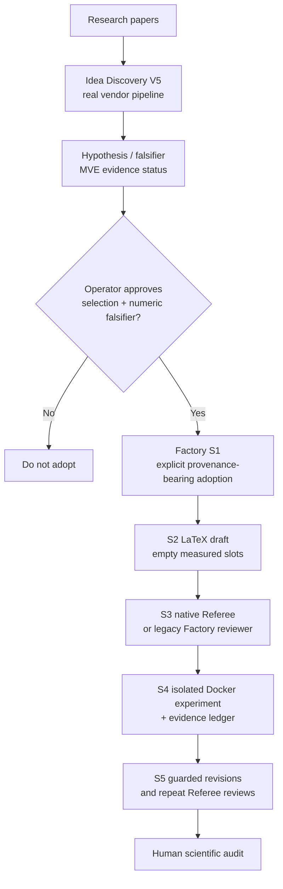

# Native Idea Discovery V5 and Referee Lean v2 integration

[← README](../README.md) · [Evidence-first guide](EVIDENCE_FIRST_V2.md) · [Reproducible demo](../examples/native_vendor_demo/README.md)

> **Status: opt-in integration, regression-tested with offline scripted fixtures.** Both vendor engines are actual code executed from the source tree, not prompts renamed as agents. Live multi-agent inference, data retrieval, Docker experiments and independent scientific review have **not** been exercised by the offline integration demo.

## Architecture: three different scientific responsibilities



*The default S1 and reviewer paths remain backward compatible.* Native execution is selected explicitly through commands or `context.json`.

## A. Native Idea Discovery V5

### Prepare and run a genuine model-backed V5 pipeline

Use a **local** research workspace and legitimate source papers (PDF, Markdown, text). Do not put API credentials in Git files or commit confidential patient data. Full V5 may retrieve external literature and transmit authorized paper excerpts to an API.

```bash
researchctl init "mri leakage audit"
researchctl idea-discovery inspect
researchctl idea-discovery prepare mri-leakage-audit

# Inspect inputs before incurring API cost:
researchctl idea-discovery run mri-leakage-audit \
  --topic "Detecting source and patient leakage in MRI evaluation" \
  --paper ./references/paper1.pdf --dry-run

# Requires the Anthropic Python dependency and a real API key:
python -m pip install anthropic
export ANTHROPIC_API_KEY="..."  # use your secret manager instead of source files
researchctl idea-discovery run mri-leakage-audit \
  --topic "Detecting source and patient leakage in MRI evaluation" \
  --paper ./references/paper1.pdf
```

The CLI invokes the real **V5** `scripts/run_pipeline.py` inside `<workspace>/_vendor/idea-discovery-v5/`. Its intermediate outputs, attack loops, falsification summary, and explicit `READY_FOR_MVE` / `GREENLIGHT` status are left intact; **generated protocols are not automatically executed**. `--with-embeddings` opts in to the heavier embedding toolchain; the default bypasses it. Avoid treating V5's model judgments as external novelty verification.

V5 has a fail-closed literature-grounding gate and is designed for a meaningful paper corpus; one source paper is supported as a CLI input but may be scientifically inadequate to obtain a surviving idea. In the offline demo, V5's real schema/semantic checker is executed but the full generation pipeline cannot run without credentials.

### Explicit adoption of a V5 survivor into Factory S1

After reading `output/falsification_summary.json`, manually review the actual idea, its primary evidence, proposed falsifier and minimum-viable-experiment plan. Only `READY_FOR_MVE` and `GREENLIGHT` ideas can be adopted. `READY_FOR_MVE` **does not imply an MVE has been executed**.

```bash
researchctl idea-discovery adopt mri-leakage-audit \
  --idea-id IDEA-001 \
  --metric dice_gap \
  --threshold 0.03 \
  --falsifier-statement "Reject the difference hypothesis if the mean Dice gap does not exceed 0.03." \
  --acknowledge-manual

# This uses the adopted single survivor with a source SHA receipt,
# without making up two additional reviewers or numeric novelty scores:
researchctl run --project mri-leakage-audit --from S1 --to S1
```

The generated `_inputs/v5_adoption.json` binds the idea to V5's result SHA-256 and requires explicit operator acknowledgement. A different source file, status, or hypothesis cannot be silently substituted before S1. **The receipt is local file integrity, not a cryptographic proof of external literature coverage or a verified scientific claim.**

## B. Native Referee Lean v2

### Structural inspection (no model or API key needed)

```bash
researchctl referee inspect manuscript.pdf supplement.pdf --output package_inspection.json
```

### Real model-backed manuscript review

The native Referee currently uses an **OpenAI-compatible** model provider and needs a valid provider endpoint/credentials; this differs from the legacy Factory reviewer that uses Claude Code authentication.

```bash
export OPENAI_API_KEY="..."
export REFEREE_MODEL="YOUR_COMPATIBLE_MODEL_ID"
researchctl referee review mri-leakage-audit ./paper.pdf \
  --provider openai-compatible --model "$REFEREE_MODEL" \
  --pipeline lean --mode deep --search-backend none
```

Set `--search-backend federated` to allow configured external source lookup, subject to API/network permissions and citation scrutiny. Native review outputs appear in `referee_native/runs/<run-id>/` under the project workspace, including state, admitted and rejected concerns, and a report only when the native evidence/invariant gates allow export.

### Re-review previously edited drafts

```bash
researchctl referee iterate mri-leakage-audit \
  ./versions/01_original.md ./versions/02_revised.md ./versions/03_revised.md \
  --model "$REFEREE_MODEL" --mode deep --search-backend none
```

This runs the native reviewer on each manuscript and calls its native revision-diff engine between successive drafts. **It does not itself modify the manuscript.** It records every assessment and revision difference in `referee_native/iteration_report.json`.

### Use the real Referee in the S3 / S5 Factory pipeline

In the new workspace's `_inputs/context.json`, select:

```json
{
  "science_mode": "exploration",
  "ledger_enabled": true,
  "review_agent": "referee-native",
  "referee_model": "YOUR_COMPATIBLE_MODEL_ID",
  "referee_mode": "deep",
  "referee_search_backend": "none",
  "review_max_rounds": 3
}
```

Now Factory S3 passes its draft to **the native Referee engine**, instead of asking the usual Factory Claude reviewer to imitate Referee roles. During S5, **the existing guarded Factory editor** (requiring Claude Code authentication) attempts to address admitted major concerns; LaTeX must compile, and Referee runs again on each revision. The native backend writes native review status and concern counts; it **does not invent the 49-dimensional Factory review scores**.

The `NATIVE_NO_ADMITTED_MAJOR_CONCERNS` status is a *technical stopping condition only*, not human acceptance or publication readiness. If the native engine cannot export a review, has hard invariant failures or has only rejected candidate concerns, Factory fails closed instead of accepting a false clean review. If major concerns remain after the allowed iterations, S5 is not marked finished. Automated revisions may still introduce uncaptured scientific errors; inspect the original, every diff, the evidence, and the final paper independently.

## C. Worked offline proof of integration

```bash
python examples/native_vendor_demo/generate_fixtures.py
python examples/native_vendor_demo/run_offline_demo.py --workspace ./tmp/vendor-smoke
python -m pytest -q tests/test_vendor_native_integration.py

# Separately, run the real bundled V5 deterministic tests:
cd ./tmp/vendor-smoke/_vendor/idea-discovery-v5
python -m unittest discover -s tests -q
```

The deterministic demonstration performs:

1. A **three-candidate scripted idea-generation response**, two scripted reviewer personas, the **real Factory falsifiability and ranking gate**, and an actual **V5 JSON-schema plus semantic audit**; no model is called and the subjective idea scores are not research results.
2. A deliberately synthetic observational manuscript with a causal overclaim; the **real native Referee Lean v2 engine** runs all seven Lean stages using an explicit scripted model fixture. The first pass admits one major concern.
3. Two transparent example revisions; the native revision-diff engine records edits and full Referee reevaluation produces admitted major concern counts **1 → 1 → 0**. The scripted fixture changes each round by design: this is a software-integration regression, **not evidence that a live AI reviewer detected or solved these problems**.
4. A separate native **package-structure-only** inspection of the included ResearchLedger manuscript PDF; this is not a peer review of its scientific content.

| Capability | Offline demonstration | Live scientific readiness |
| --- | --- | --- |
| Native V5 extraction and validation | Tested | No model call, no external novelty verification |
| Native V5 generative pipeline | Not run: no credentials | Requires authorized papers, valid API configuration and independent source verification |
| V5 → Factory single-survivor adoption | Tested | Requires an actual V5 survivor and operator review |
| Native Referee Lean engine | Three **real engine** runs with scripted responses | Requires a live OpenAI-compatible provider for real reviewing |
| Iterative manuscript revisions | Native reviewer/differ tested with prewritten drafts; Factory guarded editor loop unit-tested | Real editor+reviewer requires both model configurations and human audit |
| ResearchLedger empirical execution | Not part of this demonstration | Requires Docker, scientific datasets and full provenance checks |

### Troubleshooting

| Message | Action |
| --- | --- |
| `ANTHROPIC_API_KEY is required` | Configure the native V5 provider privately; `--dry-run` remains available without keys |
| `OPENAI_API_KEY is required` | Configure the native Referee OpenAI-compatible API; avoid pasting a secret into `context.json` |
| `model is required` | Supply `--model` or `REFEREE_MODEL` |
| `READY_FOR_MVE` | Run and independently audit the proposed minimum viable experiment before claiming empirical support |
| `native Referee failed evidence/invariant gates` | Inspect the native run `state.json`/validation status; do not force a review export |
| `NATIVE_MAX_ROUNDS` | Major concerns remain; address them manually and begin a new evidence-tracked revision |
| `referee-native` needs a guarded revision | Install/authenticate Claude Code, Docker/LaTeX toolchain as required for the whole Factory workflow |

**No independent benchmark**, masked expert evaluation, real-world dataset experiment, or live provider run is claimed by this integration document.
