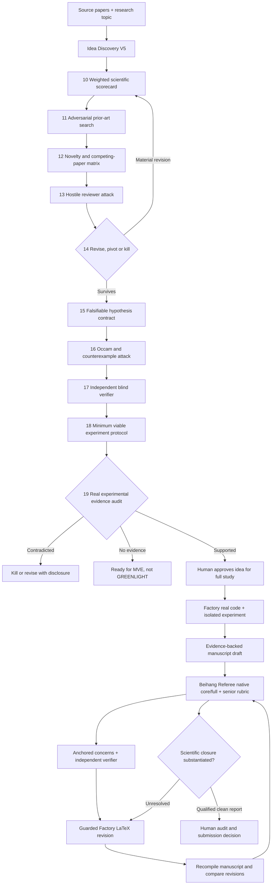

# Idea Discovery V5 × Beihang Referee — evidence-first improvement loops

> **What is integrated:** the bundled V5 research agent and its native Phase 10–19 pipeline; a **second**, newly uploaded Beihang Referee v0.1.0 engine (the older Referee Lean v2 remains available); and a trusted supplemental reviewer rubric taken from the user's `Prompt(3).txt`. These can now be driven through `researchctl` rather than merely asking a general-purpose model to read an agent description.
>
> **What is not demonstrated:** live provider-backed idea generation, independent academic reviewing, actual novelty confirmation, a verified publication-ready manuscript, or a full live model-driven end-to-end revision. Scripted offline tests validate software behavior only.

## Three distinct scientific loops



**Phase 10–16 is not the whole scientific gate.** V5 has Phase 17 blind verification, 18 minimum viable experiment specification, 19 evidence auditing. No real executed MVE evidence means **READY_FOR_MVE**, not **GREENLIGHT**. An idea amended after falsification must revisit Phase 10 and re-search prior art. The native V5 engine implements these rules; ResearchLedger's standalone phase-audit verifies recorded artifacts, not the truth of their model judgments.

## Setup

Python 3.10+, Claude Code authenticated for the Factory *revision* stage, pdflatex/BibTeX for LaTeX, Docker for generated experiments, a supported OpenAI-compatible Referee model for live reviews, and Anthropic access for live V5 ideation are required. The uploaded Python Referee bundle has CLI pipelines **`core`** and **`full`**; the older bundled Lean v2 still uses **`lean`** and **`legacy`**.

```bash
python -m pip install -e '.[dev,referee,idea-discovery]'
researchctl doctor
researchctl init "llm agentic blockchain provenance"
# Put authorized background PDFs in ./references and enter topic in the
# project workspace's _inputs/topic.md (the CLI prints its location).
```

### A. Idea development — use ALL phases, don't skip attacks

```bash
researchctl idea-discovery inspect
researchctl idea-discovery prepare llm-agentic-blockchain-provenance
# DRY RUN — checks inputs, no external model inference:
researchctl idea-discovery run llm-agentic-blockchain-provenance \
  --topic "Can agent decisions be traced to cryptographically authenticated evidence?" \
  --paper references/prior_work.pdf --dry-run

# LIVE — requires privately configured ANTHROPIC_API_KEY, network and credits:
researchctl idea-discovery run llm-agentic-blockchain-provenance \
  --topic "Can agent decisions be traced to cryptographically authenticated evidence?" \
  --paper references/prior_work.pdf

# Only after actual V5 output files exist:
researchctl idea-discovery phase-audit llm-agentic-blockchain-provenance --idea-id IDEA-001
# Review the attack loop and falsification records before manually adopting:
researchctl idea-discovery adopt llm-agentic-blockchain-provenance \
  --idea-id IDEA-001 --metric audit_detection_rate --threshold 0.9 \
  --falsifier-statement "Reject the target if detection rate is below nine tenths." \
  --strict-phases --acknowledge-manual
```

**Strict phase audit** checks Phase 10–16 JSON artifacts for each selected idea and disallows reported validation errors. It does not independently validate cited prior work, the study design, or Phase 17–19 empirical evidence. Check the entire V5 output and actual MVE evidence before claiming scientific readiness.

### B. Native Referee — your senior review rubric + authentic runtime prompts

You supplied `Prompt(3).txt`; its academic requirements are included at `factory/steps/review_assets/senior_review_rubric.txt`. The upgraded Beihang CLI supports `--rubric-file`: during the *core-reviewer* stage it appends your rubric to its native prompt. It does **not** replace JSON schema, deterministic evidence admission, or the independent verifier's blind review contract. The prompt hash is recorded in the run configuration. You may substitute another approved rubric with `--rubric`.

```bash
# Test the new runtime without a model (the actual Beihang software is executed):
export PAPERFACTORY_WORKSPACES=/path/to/research/workspaces
researchctl referee cycle llm-agentic-blockchain-provenance \
  path/to/v1_manuscript.md --provider scripted --mode standard \
  --search-backend none \
  --fixture 'vendor/20- Paper Review Agent/Beihang-Referee/examples/demo_responses.json'
```

The provided scripted responses were written for Beihang's demonstration manuscript, **not** for another research paper. For a meaningful offline test, run the exact vendor demo input/fixture pair. Never reuse canned fixture conclusions as manuscript criticism.

```bash
# Real review, with actual LLM calls and optionally live scholarly retrieval:
export OPENAI_API_KEY='<your-provider-api-key>'
export REFEREE_MODEL='<supported-model-id>'
researchctl referee cycle llm-agentic-blockchain-provenance \
  path/to/manuscript_v1.pdf path/to/manuscript_v2.pdf \
  --pipeline full --mode deep --scorecard \
  --search-backend federated
```

Round 2 is routed to Beihang's **revision DAG** with the previous document and concern set. The native engine compares revisions and evaluates closure/regressions. Each round stores the input checksum, unmodified review artifacts, an explicit concern list and revision diff. **Drafts supplied to `referee cycle` must already exist; this operation reviews and compares them, it does not secretly write new versions.**

### C. Factory's automatic guarded manuscript revision loop

Set these fields in the project workspace `_inputs/context.json` (alongside your existing settings):

```json
{
  "review_agent": "beihang-native",
  "review_max_rounds": 4,
  "referee_pipeline": "full",
  "referee_mode": "deep",
  "referee_scorecard": true,
  "referee_search_backend": "federated"
}
```

`researchctl run --project llm-agentic-blockchain-provenance` now selects the new Beihang runtime for S3/S5 instead of the historical Lean-v2 bridge. Factory's **existing Claude Code revision agent** remains responsible for producing edited `.tex` files, subject to restrictions on invented numbers and citation keys; each revision must compile before re-review. The new runtime receives prior manuscript and concern context in revision mode. A peer-review score cannot prove scientific truth.

## Evidence gates that are NOT optional

| Gate | Prevents | Claim that may be made |
| --- | --- | --- |
| Phase 11/12 competing work | Unsupported claims of originality | "Prior-art comparison attempted" if sources actually checked |
| Phase 14 fatal-defect handling | Keeping a clearly invalid idea | "Provisional idea survives recorded attacks" |
| Phase 15/16 testability | Vague hypotheses or unnecessary complexity | "A falsifiable experiment is specified" |
| Phase 17 blind verification | Self-approval based on generator's reasoning | "An independent review context was invoked"; not necessarily a different model |
| Phase 18/19 MVE results | Declaring an untested idea scientifically successful | "READY_FOR_MVE" or an evidence-qualified outcome |
| Referee evidence lock | Unsupported major reviews and invented page anchors | "Model concerns passed the configured admission logic" |
| Revision closure | Rhetorical response with no paper change | "Revision was compared and audited; unresolved items retained" |
| Independent human evaluation | LLM self-confirmation | Only a qualified human reviewer can certify their own expert assessment |

**Stop policy:** attempt only a configured number of meaningful revisions; never loop indefinitely; stop on unchanged manuscript hash, serious new unsupported claims, unrepaired compilation, unresolved blockers or budget exhaustion. Zero admitted model concerns does not guarantee acceptance or even correctness.

## Auditability and limitations

- Review outputs record actual paths, draft SHA-256, admitted concern counts, native engine version, the trusted rubric digest and whether fixtures or live inference were used.
- Canned fixtures are reproducibility tests for software **not** evidence of scientific review accuracy.
- With real credentials, uploaded manuscripts can be sent to an external LLM service and federated search providers; check consent, copyright and journal policy first.
- V5 may call external literature services; novelty requires verifying the content and chronology of the retrieved papers, not merely metadata.
- A failed gate is not permission to replace experimental results with invented numbers. Any revised causal or generality claim must be traceable to empirical data.
